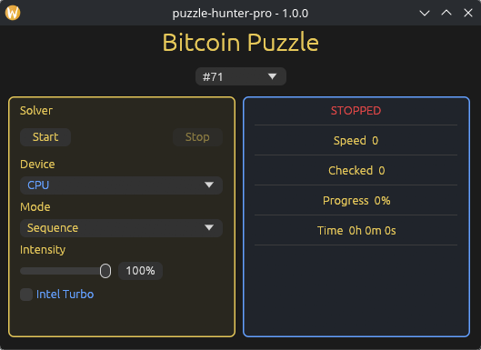
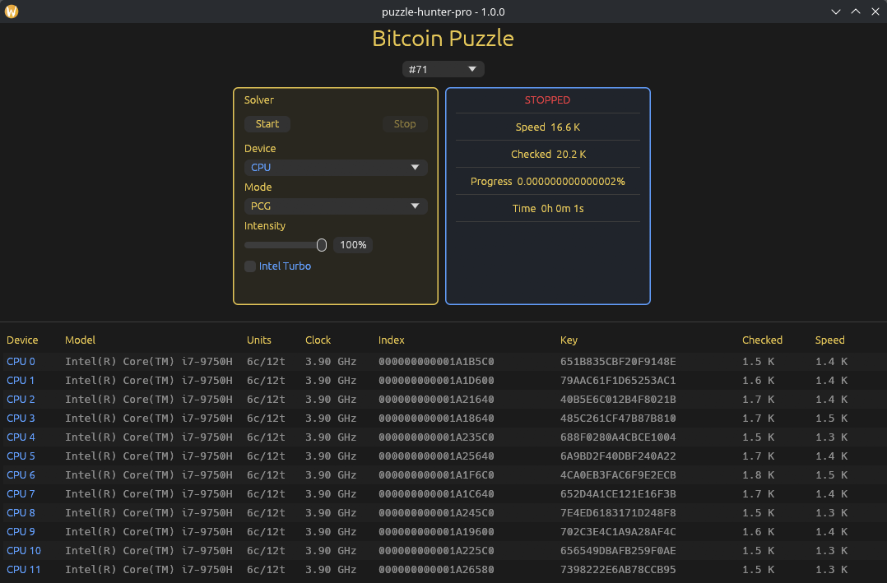
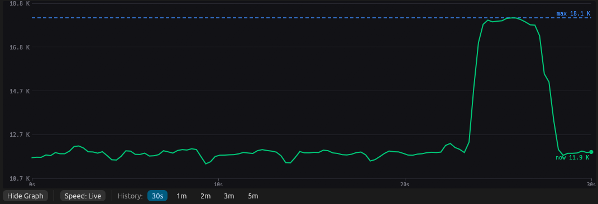

# History

When I was a kid, still in elementary school, maybe I was 13-14 years old, my father knew a guy, who has a auto-repair shop. Guy was really popular and my father visited him many times. He had auto parts for what every you needed. This was his thing. He could sell you any car part. I am still a kid. Sitting at home and just writing code. So they head an idea, me writing something useful. The idea was to program his auto repair shop and create the database.

## First app

When my friends try to chase girls during the sommer vacation, I stayed at home finally and nobody said anything, if anything, I was encouraged to do more. Finally I let my brain program for 3 months. No sleeping at night, after the lunch go sleep less, wake up quick and continue as dark comes. I killed it!! I fucking made it so good so good that even today, me and my father every time when we speak about this, are having bad day afterwards. I created in Visual Basic NET a window. My first useful GUI for someone. 

When you start app you selects auto brand: BMW, Mercedes, Audi, Ford, Hyundai... Every auto had its logo so you could without reading quickly click the proper icon and go to next menu where you selected which part auto part. And as a kid I had to learn about every single body part to create this menu, and you could click any part, there was a icon, and icons were so sorted out that you could see the whole car when you zoom out. When you selects body part you come to new menu where you see how many are there available on stock, the price, delivery time if not available, repair time, technician name, check. When you click it could print the bill. As a kid i did it, and I am still sorry that I did it at all. I learned a wrong thing unfortunately from this.

When I was done, I burned the full compiled EXE file to a CD. Yes we are in that time line. There are no USB-Sticks. There are CDs. So I burned it, and me and my father went there. I gave him the CD to test and tell me if it is working as he wanted...

We went home and i went sleep. My father woke me up, he was upset. It seams that this guy does not need my app at all, he wants to do this job manually with pen and books. I was sorry. A lot. i thought I created a really good thing. I still beleive in this. How the fuck is not my thing better as manually taking book by book and searching for pages of text just to hear: Oh I am sorry i do not have this part behind my back. How? You could in 2 click know that! 2 click!!!!

And then I realized... 

I gave him a full compiled production version to "test". He copied it to his PC and that's it. He does not need to buy it, he already has it. So I got my CD back. So what I learned as a kid, I will implement now:

# ha-ha here we go again

## License

Before we start reading any further, i want that you understand one thing. This is my program, I wrote it. I do not want to hide it behind any private repository, I want this to be open-sourced. What i mean is, i want that you see what I wrote, you can inspect the code, you can see there real purpose of the app by inspecting it, by testing it on your machine, on any machine which you want. you can use it as much as you want. It is allowed to use this app even on toilette. No problem there, but:

1. There is no modification of this app. it is as it is. I control my app and rights to modify it. You do not have this right.
2. If you want to use it it is free, and will stay free forever. No changing this idea at all. All my things were, and will stay for free.

Here comes the BUT:

3. but, cuda kernels are not for free. They are paid product which you will get when you pay for it.

## Product: Puzzle Hunter Pro (PHP v1)

I am releasing first specialised app for resolving famous Bitcoin "puzzle" created 2015 by anonymous user called saatoshi_rising on a internet forum. There is not so much information about who this person is but what is known is what has to be done. It is really a simple task when you really thing about it. The trick is the speed and how to use this properly.

PHP version 1 covers all unsolved puzzles from #71 until #160. There are a lot of Bitcoins to earn. More than 900.

Core of my app is simple. it is written in Rust, since Rust is the best one (I see people rolling their eyes right now). I used a EGUI framework to create windows and move from a terminal mode as we had by old implementation key-hunter. Now you can start whole process with your mouse and no effort.

Look at this simple interface:



There is everything what you need for this app to run for free. Nothing more.

You have `Start` and `Stop` button. Device is already set to CPU. So you do not have to touch that. Mode is how this puzzle solving thing is working. Right now there are two modes:

### Sequence

Let's play a game now: I tell you to pick one number between 0 and 1000. Which one did you pick? ok. ok. settle down. So lets play a bit harder game. Let's pick one number between 0 and 1000000000000000000000000000000000000000. hahahahahahhaha. Do you even know what this number is: 1000000000000000000000000000000000000000. How many zeros are here. Can you count them down? one two three four... This is Sequence mode.

I do not know which number you picked between 0 and 1000000000000000000000000000000000000000. i have to guess. So I ask is it 1? You say no. I ask again, is it 2? You say no.  I ask again, is it 3? You say no. In one moment I will say some number and you will say yes. Puzzle is solved. You earned some Bitcoins. How much? A lot!

### PCG

Again, we are playing the same game, pick one number between 0 and 1000000000000000000000000000000000000000. But instad of doing 1,2,3, I say 113709064508249507803142502696355969381. Then my app checks if this is the number, no. then I say 520266663734039442791445572358064744377, app checks, no. then i try some other number, but how this works actually and which number is next you ask?

I wanted to create a uniques experience for every user. I want this to be more like a Bingo game. Everybody have their unique ticket. But everybody play same rules.

I created a logic which will based on your hardware-id create a number which is feed to a PCG generator to produce almost as random number generation. But it is not random, since random can repeat same number if you let it running for some time. PCG is mathematical way to jump from start to end then a bit back and forward and here and there, but NEVER on same place more then one time.

This is the way to generate "random" numbers and try this values instead of 1,2,3.


Which one is better, statistically, none. The puzzle creator created this puzzle randomly. There is no way of knowing where is the solution. It is somewhere there. 


### Intensity

It just tells your PC how much effort to give for solving this puzzle. By default is 100%. You can lower it to 10% and do what ever you want with you PC. I even played games without noticing PHP in background. I am running this app more that 7 months on my gaming laptop non-stop. I watch youtube in 4k. Compiling another apps. No problem there.


### Intel Turbo

This option can be used only if you are root. But nobody will download this app and start is as a root. Fuck no. I would never do it. So I would a way how to resolve this on my machine without starting app as a root. 

On Arch Linux you have to create a file:

```
sudo nano /etc/sudoers.d/intel-turbo
```


Inside you have to save this text:

```
your_username ALL=(root) NOPASSWD: /usr/bin/tee /sys/devices/system/cpu/intel_pstate/no_turbo
```

So what this does is, is allowing only your username to write to one file only and this is file no_turbo. What actually application writes there is zero or one. Zero is for enable turbo by Intel CPU, and 1 is to disable Intel Turbo on your CPU. That's it. There is no need to start app as sudo, when we only need to write to one single file, if we want to. 

If you do not want to change anything on your system, you do not have to. This checkbox will not work for you when you click it. But if your Turbo mode is activated app will use torbo mode, it it is disabled by your system, then it will work without any turbo no problem.

And yeah that's it. This are all setting which you can use in this app. 

In the blue frame are statistic, like speed of your system, how much keys are you checking in one second. You can see how many keys did you try so far. Progress of the puzzle can be also seen. Besides how many time did you spent in this sessions, there is nothing more.

But wait is there more? That's it ?!?


### Table

This would be too simple to use if we had no table. My whole life is somewhere in the table saved. So I created one here also:




Look at this beauty. We have columns, we have rows, what more do you need... 

App will detect how many cores and threads your PC has and it will create one entry for them. My system has 6 cores and 12 threads. You can see this in column "Units". In column "Model" you can see the name of your CPU. Or mine here. Clock column will show the speed of you solver in real time.

#### Index and key

In this example we are running PCG mode. That's why column Index and Key are a bit different. In Sequence mode both columns would have same values. I know it is a bit confusing, and I wanted to hide the Index column from you and show only key since this is the real key which we are checking. Index column is just visually showing the progress of the solver if we did not start it in PCG mode.

So to put it simply, ignore index and focus on the Key. This is what we are checking. And there is also column to show you how many keys did you check and the speed of this device.

So far so simple? And now are we done? Not even close. What is excel table without any chart? nothing. So here it comes:

### Graph

I wanted to see how my speed behaves with a time, so a simple graph with a history, why not. Here it is:



So what is on this graph. There is a timeline. 30 seconds are on this graph. Solver started with around 12K keys per seconds and stayed there approximately for 22 seconds and then I turned Intel Turbo ON and speed of my solver went up to maximum of 18.1K keys/s until I disabled Intel Turbo few seconds after. Then speed went down. Simple. History can be increased up to 5 minutes.

Also we can observer Live speed of solver, or the Global speed of the system. 

If you do not like the Graph, then you can hide it. It will not work in background when you hide it, so it will not use your CPU to generate it, giving you CPU solver a bit of a push. You'll see when you test it.


### Final FREE product

This is a preview of a FREE version of the app.

<video controls style="max-width: 100%; width: 600px;">
  <source src="/assets/article_images/2026-12-25-puzzle-hunter-pro/free-version.mp4" type="video/mp4">
  Your browser does not support the video tag.
</video>

