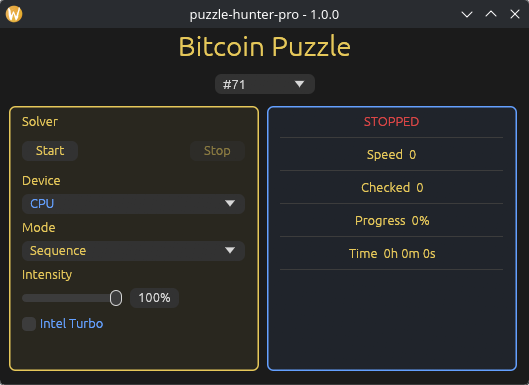
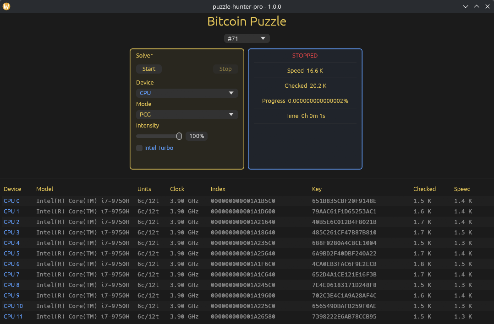
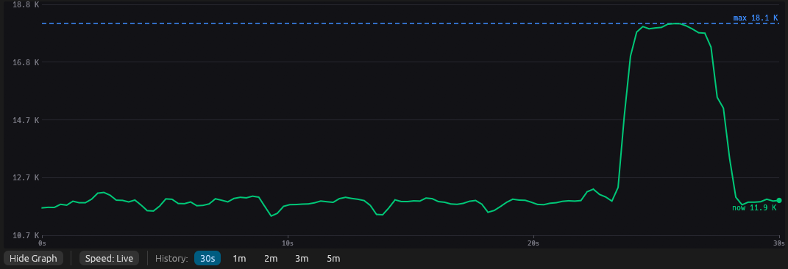
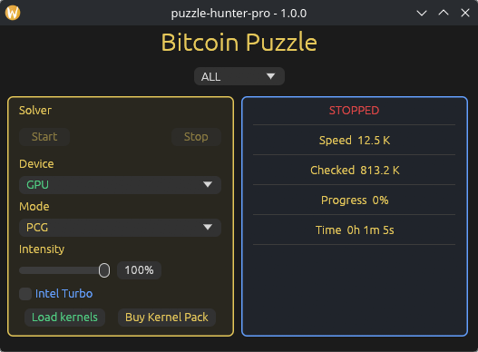
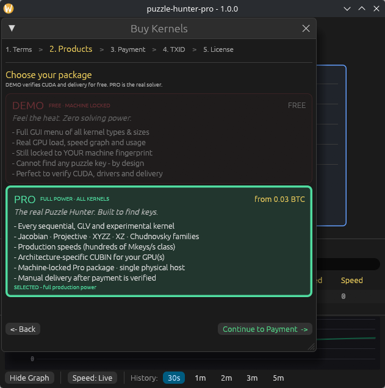

## History

When I was a kid, still in elementary school, maybe 13 or 14 years old, my father knew a guy who had an **auto-repair shop**. The guy was really popular, and my father visited him many times. He had **auto parts** for whatever you needed. This was his thing. He could sell you any car part.

I was still a kid, sitting at home and just writing `code`. So they had an idea: me writing something useful. The idea was to program his auto-repair shop and create the `database`.

## First app

When my friends tried to chase girls during the summer vacation, I finally stayed at home, and nobody said anything. If anything, I was encouraged to do more. Finally, I let my brain program for three months. No sleeping at night. After lunch go to sleep, wake up quick, and continue as dark comes. I killed it!!! I fucking made it - so good, so good, that even today, every time my father and I speak about this, we end up having a bad day afterwards. I created in **Visual Basic.NET** a window in **mySQL** a database. My first useful `GUI` for someone.

When you start the app, you select the car brand: BMW, Mercedes, Audi, Ford, Hyundai, and more. Every auto had its logo, so you could, without reading, quickly click the proper icon and go to the next menu, where you selected which **auto part**. And as a kid, I had to learn about every single body part to create this menu. You could click any part, there was an icon, and the icons were so sorted that you could see the whole car when you zoomed out.

When you select a body part, you come to a new menu where you see how many are available in stock, the price, delivery time if not available, repair time, technician name, check. When you click, it could print the bill. As a kid, I did it, and I am still sorry that I did it at all. I learned the wrong thing from this, unfortunately.

When I was done, I burned the full compiled `EXE` file to a CD. Yes, we are in that timeline. There are no USB sticks. There are CDs. So I burned it, and my father and I went there. I gave him the CD to test and tell me if it was working as he wanted...

We went home and I went to sleep. My father woke me up. He was upset. It seems that this guy does not need my app at all. He wants to do this job manually as before with pen and books. I was sorry. A lot. I thought I created a really good thing. I still believe in this. How the fuck is my thing not better than manually taking book by book and searching for pages of text just to hear: "*Oh, I am sorry, I do not have this part behind my back.*" How? You could know that in 2 clicks! **2 clicks**!!!!

And then I realized...

I gave him a full compiled production version to "test". He copied it to his PC and that's it. He does not need to buy it. He already has it. So I got my CD back. So what I learned as a kid, I will implement now.

That lesson stuck. For life. For years after that I kept writing stuff and giving it away. Sometimes people used it, sometimes they didn't. I never really made money from `code`. I survived. Mentally. Physically. There were times when the only thing that kept the day going was writing the code. You know the feeling when you look at the screen at `3AM` and you don't even know if what you just wrote is correct, but you cannot stop. Why should you? That was my normal for a long time.

I am not telling this for pity. I am telling it because when somebody looks at the price of the `kernel pack` and says "zero point zero something BTC is a lot", I want them to know what sits behind it. Years of nights. Years of learning math I hated. Years of running the same experiment again and again until the `GPU` finally gave me the number I wanted. I did not have a team. Just me, a laptop that was never fast enough, that I pushed until the fans sounded like a vacuum cleaner.

## Free version

### License

Before we start reading any further, I want you to understand one thing. This is my program. I wrote it. I do not want to hide it behind any **private repository**. I want this to be `open-sourced`. What I mean is: I want you to see what I wrote. You can inspect the code. You can see the real purpose of the app by inspecting it, by testing it on your machine, on any machine you want. You can use it as much as you want. It is allowed to use this app even on the toilet. No problem there. But:

1. This app cannot be modified. It is what it is. I control the app and have the rights to modify it. You do not have these rights.
2. If you want to use the app, you can do so for free and it will always remain free. This will never be changed. Everything I create will always be free.
3. `CUDA kernels` are not free. They are a paid product that you will receive when you pay for it.

## Product: Puzzle Hunter Pro (PHP v1)

I am releasing the first specialised app for resolving the famous Bitcoin "`puzzle`" created in 2015 by an anonymous user called **saatoshi_rising** on an internet forum. There is not so much information about who this person is, but what is known is what has to be done. It is really a simple task when you really think about it. The trick is the speed and how to use this properly.

PHP version 1 covers all unsolved puzzles `from #71 until #160`. There are a lot of Bitcoins to earn. More than **900**.

The core of my app is simple. It is written in `Rust`, since Rust is the best one (I see people rolling their eyes right now). I used an `EGUI` framework to create windows and move from a terminal mode as we had in the old implementation key-hunter. Now you can start the whole process with your mouse and no effort.

Look at this simple interface:



There is everything you need for this app to run for free. Nothing more.

You have `Start` and `Stop` buttons. Device is already set to CPU. So you do not have to touch that. Mode is how this puzzle solving thing is working. Right now there are two modes:

### Sequence

Let's play a game now. I tell you to pick one number between 0 and 1000. Which one did you pick? Okay. Okay. Settle down. So let's play a bit harder game. Let's pick one number between `0 and 1000000000000000000000000000000000000000`. Hahahahahahhaha. Do you even know what this number is: 1000000000000000000000000000000000000000. How many zeros are there? Can you count them down? One, two, three, four, five, six, seven, eight, nine...

I do not know which number you picked between 0 and 1000000000000000000000000000000000000000. I have to guess. So I ask: is it 1? You say no. I ask again: is it 2? You say no. I ask again: is it 3? You say no. In one moment I will say some number and you will say yes. Puzzle is solved. You earned some Bitcoins. How much? A lot! This is `Sequence` mode.

### PCG

Again, we are playing the same game: pick one number between 0 and 1000000000000000000000000000000000000000. But instead of doing 1, 2, 3, I say `113709064508249507803142502696355969381`. Then my app checks if this is the number - no. Then I say `520266663734039442791445572358064744377`, app checks - no. Then I try some other number. But how this works actually, and which number is next, you ask?

I wanted to create a unique experience for every user. I want this to be more like a **Bingo** game. Everybody has their unique ticket. But everybody plays the same rules.

I created a logic which will, based on your `hardware-id`, create a number which is fed to a `PCG` generator to produce almost-as-random number generation. But it is not random, since random can repeat the same number if you let it run for some time. 

PCG is a mathematical way to **jump** from start to end, then a bit back and forward and here and there, but **NEVER** on the same place more than one time.

This is the way to generate "random" numbers.

Which one is better, statistically? None. The puzzle creator created this puzzle randomly. There is no way of knowing where the solution is. It is somewhere there.

### Intensity

It just tells your PC how much effort to give for solving this puzzle. By default it is **100%**. You can lower it to 10% and do whatever you want with your PC. I even played games without noticing PHP in the background. I am running this app more than 7 months on my gaming laptop non-stop. I watch YouTube in 4K. Compiling other apps. No problem there. I am writing this, and my solver is still active in background. 

### Intel Turbo

This option can be used only if you are **root**. But nobody will download this app and start it as root. Fuck no. I would never do it. So I found a way how to resolve this on my machine without starting the app as root.

On **Arch Linux** you have to create a file:

```
sudo nano /etc/sudoers.d/intel-turbo
```

Inside you have to save this text:

```
your_username ALL=(root) NOPASSWD: /usr/bin/tee /sys/devices/system/cpu/intel_pstate/no_turbo
```

> Replace **your_username** with your real username

So what this does is allowing **only** your username to write to one file **only**, and this is the file `no_turbo`. What the application actually writes there is zero or one. Zero is to enable turbo by Intel CPU, and 1 is to disable Intel Turbo on your CPU. That's it. There is no need to start the app as sudo, when we only need to write to one single file, if we want to.

If you do not want to change anything on your system, you do not have to. This checkbox will not work for you when you click it. But if your Turbo mode is activated, the app will use turbo mode. If it is disabled by your system, then it will work without any turbo, no problem.

And yeah, that's it. These are all the settings which you can use in this app.

In the blue frame are statistics, like the speed of your system, how many keys you are checking in one second. You can see how many keys you did try so far. Progress of the puzzle can be also seen. Besides how much time you spent in this session, there is nothing more.

But wait, is there more? That's it ?!?

### Table

This would be too simple to use if we had no table. My whole life is somewhere in the table saved. So I created one here also:



Look at this beauty. We have columns, we have rows, what more do you need...

The app will detect how many cores and threads your PC has and it will create one entry for them. My system has 6 cores and 12 threads. You can see this in the column "**Units**". In the column "**Model**" you can see the name of your CPU. Or mine here. The **Clock** column will show the speed of your solver in real time.

### Index and key

In this example we are running PCG mode. That's why the columns Index and Key are a bit different. In Sequence mode both columns would have the same values. I know it is a bit confusing, and I wanted to hide the Index column from you and show only the key, since this is the real key which we are checking. The Index column is just visually showing the progress of the solver if we did not start it in PCG mode.

So to put it simply, ignore the index and focus on the `Key`. This is what we are checking. And there is also a column to show you how many keys you did check and the speed of this device.

So far so simple? And now are we done? Not even close. What is an Excel table without any chart? Nothing. So here it comes:

### Graph

I wanted to see how my speed behaves with time, so a simple graph with a history, why not. Here it is:



So what is on this graph. There is a timeline. 30 seconds are on this graph. The solver started with around 12K keys per second and stayed there approximately for 22 seconds, and then I turned Intel Turbo ON and the speed of my solver went up to a maximum of `18.1K` keys/s until I disabled Intel Turbo a few seconds after. Then the speed went down. Simple. History can be increased up to 5 minutes.

Also we can observe `Live speed` of the solver, or the `Global speed` of the system.

If you do not like the Graph, then you can hide it. It will not work in the background when you hide it, so it will not use your CPU to generate it, giving your CPU solver a bit of a push. You'll see when you test it.


### Final FREE product

This is a preview of the FREE version of the app.

<video controls style="max-width: 100%; width: 600px;">
  <source src="/assets/article_images/2026-12-01-puzzle-hunter-pro/Free.mp4" type="video/mp4">
  Your browser does not support the video tag.
</video>


So, is there more? **YES!**

## Pro version

### Why?

So far the CPU solver is free and everybody can use it. For those who want more speed, the only option is to use a few tools on the market. Be my guest. I am not saying anything negative about them. I used them. I tested them. So far so good. Here comes the but again, but, I wanted more. I really wanted something fancy. So I created the first `Jacobian` kernel with CUDA. This was a first try to get any speed from it. I wrote a whole post about this. Check the Key-Hunter post. But this was also not enough. I know how to use terminal applications, been a long time on Linux, but why not create a window with a few buttons and some visualizations of what I am doing. Debugging is hard.

After I created a collection of kernels, I realized what I have here. I have a game changing mechanics to solve this puzzle before everyone. I just need more GPU cards. Since I had a **Mining** rig with 13 Radeon 570 graphic cards, just before my first child was born. 2.5K watt of energy. What I want to say, I know how to create frames, make this compatible, really good cooled. A small farm in my extra room... I am still dreaming. I am too old for this stuff, maybe my kids will take over. Who knows.

Sharing is caring? But who cares about me? About my effort taken here? Fucking nobody. Not pessimism, a reality. So, let's be real. You want to use my machine? Pay for it. Do not want to pay? No problem for me. I'll just sweep all puzzles at the same time with PCG. Oh, did I forget to tell you about my best idea so far?

I spent months just on the kernels. Not weeks. Months. Jacobian, then projective, then `XYZZ`, then the Chudnovsky variants, then the pure XZ differential path, then the ones that only care about the public key for the higher puzzles. Every single one had its own special tricks. I rewrote the same function more times than I can count. Some nights the speed went up. Some nights it went down and I sat there staring at the numbers like an idiot. In one moment my app was almost 1 GB big in rust debug mode. Do you know how long do you have to wait for it to start when you start compiling it? Fuck sake. 

And still the free version is `free`. The CPU solver, the GUI, the table, the graph, the ALL mode logic, the progress that survives restarts, all of that is free. The thing you pay for is the compiled `CUDA`. That part is the part I will not give away again. **I already learned that lesson when I was 14**.

## From one puzzle to all of them

This is the part most people will never see and I almost never talk about, because it sounds boring until you actually have to do it.

I started with puzzle `#72` only. Hardcoded. Target HASH160 baked into the kernel. `total_bits` fixed at 72. First-word gate fixed. Everything tuned for that one range. It worked. It was fast enough for me at the time. Then I wanted the next one. Then the one after that. Then I looked at the list from #71 to #160 and realised that if I keep doing this one by one I will still be here in three million years.

So I had to change the whole approach. One compiled kernel binary must be able to solve any unsolved puzzle in that range without recompiling for a fixed target. That sounds simple when you say it. It is not simple when every single kernel was written with the old assumptions. So I rewrote all my kernels again. 

I kept a documentation for this. Every time a kernel was ported I updated it so the next one would follow previous kernel logic. It still took a long time. Some kernels were clean. Some fought me for days because the old assumptions were deep in the hot path.

None of this is visible when you just click Start. That is the point. The free tools on the market do not have this history, because most of them were never written to cover the whole remaining set with one binary and one work allocator.

## ALL mode

Imagine this: Every day wake up, bring children to school, go to job. Come home at 7PM, play with children until 9PM, write code until 12PM. Repeat one year. Every day, every day, every day. I went insane. I have friends in IT who probably know more things than I do, but when I start speaking about my PHP app, I see in their eyes they are lost. Nobody understands this shit. I translated a Key-Hunter post to my father on our language and he read it for an hour. Missed about 99% of what I did. Fucking math. I hate it, as a kid I hated it even more. Did I mentioned it already?

Writing a sequential Bitcoin address generator is a mathematical nightmare. I managed to learn it at night. Implement it, debug it, and ultimately push it to **101%** of my GPU limit. Every day I go to sleep thinking what is the next move for tomorrow. Sometimes I am so excited from my progress that I cannot sleep properly. In the morning I am like a zombie. One night, after I successfully implemented support for all unsolved puzzles, I realized, why am I focusing on one puzzle? Why not solving all puzzles? And then it hit me.

### Round-robin

This is how I designed it:

- Start the solver in `ALL` mode
- The solver starts solving the first unsolved puzzle #71 and does X amount of batches there
- The solver switches to puzzle #72 and does some solving there
- The solver does the next puzzle until ultimately the last puzzle #160 is solved for some time
- The process comes back to puzzle #71 and continues where it finished in the first round
- The process continues until you stop it

Nothing so special, but, what if I start PCG mode and set that X is 15 seconds?

I would spend 15 seconds on puzzle #71 and "randomly" test billions of keys.  
Then I would spend again 15s on puzzle #72 and "randomly" test billions of keys. 

Around 20 minutes later I am back to puzzle #71 doing billions of tests.  
The process does not stop for months. I am probing ALL puzzles. 3 times per hour I check ALL puzzles so many times that I do not know what comes after billion billion billion keys. A lot ;)

When you run ALL mode with PCG, every machine that has the Pro kernels is covering different ranges at different times. The chance that two people are checking the exact same keys at the exact same second drops hard. That is the point. The free tools on the market usually hammer one puzzle at a time in a straight line. Fine. But the range is huge. I wanted something that keeps moving across all of them without me having to sit there and switch tabs every hour.

There is also the boring part that nobody talks about: `progress` that survives. When the solver finishes a turn on puzzle #71 and moves to #72, it still remembers where it left the previous one. Restart the app, come back next week, it continues from the farthest point it already reached, not from zero. I had to get that right or the whole round-robin idea falls apart.

Program when started for a first time, will create a folder `status` and save progress of every puzzle there. When started again, it will backup the folder status. Why not.

So, who has that? I am:


<video controls style="max-width: 100%; width: 600px;">
  <source src="/assets/article_images/2026-12-01-puzzle-hunter-pro/ALL.mp4" type="video/mp4">
  Your browser does not support the video tag.
</video>


It will take you some time to realize how powerful this is.

So is there more?

## GPU

So far we spoke only about the free version. After you switch Device to GPU, new buttons will be available for you, one of them is `Buy Kernel Pack`.



When you accept my terms of service, you can buy the kernel pack. For those sceptical bastards, I created even a `Demo` for fuck's sake. Try to request it just to see how it works. When you are ready, you can request the real thing. Right now this is the product window:



When you decide to buy, here is how it works:

- The app detects your hardware specification (for compiling the proper kernels)
- You have the option to pay with crypto, choose your coin
- Send the desired amount to the address given only to you
- Enter transaction ID in next step
- Send an email to the email address given only to you

So let me explain a bit here since I know there will be users who have no idea what they are doing...

When you start the buying process, a crypto address will be generated only for you. Every user gets their deposit address. After you pay the desired amount, copy your Transaction ID into the app to verify the payment. 

Then you will get to a new process of generating an email. In order to protect your security, I do not want that anyone is able to know what you bought besides `ME AND YOU`. I will honour confidentiality here. 

The program will generate an encrypted message which you will have to send to an email address shown in the process. This email address is only for this machine. 

> Every machine has its own email and crypto address. 

Everything that is sent online is the email and it is encrypted. When the kernels are compiled according to the encrypted request, a kernel package will be sent to the email address which you stated in the order process. Please make sure you can receive emails on this address. The `OWL` file is below 10 MB.

The kernels themselves are the real product. Different coordinate systems, different trade-offs. Some are better when you run many parallel keys. Some prefer fewer but heavier. Some are tuned for the known-pubkey puzzles higher up.

When I get your request, and after I verify that everything is OK, I will compile the kernels and send them to you. This is how loading of the `Demo` and `Pro` kernel is working:

<video controls style="max-width: 100%; width: 600px;">
  <source src="/assets/article_images/2026-12-01-puzzle-hunter-pro/Kernels.mp4" type="video/mp4">
  Your browser does not support the video tag.
</video>

And finally: is that it?

No, of course not. We did not speak about benchmarking the card. Which kernel parameter is the best for your card? I have no idea. That's why we have now benchmarking for a single kernel or all of them. Please notice that benchmarking all kernels takes some time. But since you have to do this only once, it pays off.

<video controls style="max-width: 100%; width: 600px;">
  <source src="/assets/article_images/2026-12-01-puzzle-hunter-pro/Benchmark.mp4" type="video/mp4">
  Your browser does not support the video tag.
</video>

Please notice that not all kernels have their maximum with identical kernel parameters. Some of them like many parallel keys, another not so much. You need to find your golden value.

And now, now I have nothing more to say. Most of the other stuff is too abstract to speak about.

I wish you a happy hunting. I would be so proud if one of you solves some puzzles with my app. I think this would make me more happy than anything else.

---

## Thank you saatoshi_rising

I know that one day you will read this. This section is only for you.

When I first saw the puzzle I did not understand what a scalar multiplication on an elliptic curve even was. I knew the formula for a line. I remembered that sin and cos exist. That was my level. One year later I can tell you with a straight face what I had to learn to make this application real.

I had to learn the group law on secp256k1 in every form that actually matters for sequential search. Affine is too slow. So I went to projective coordinates, then Jacobian, then XYZZ, then Chudnovsky. I learned why the mixed-addition formulas with a fixed generator G dominate the inner loop, and why hoisting that generator into registers or constant memory changes the whole profile of the kernel. The difference between an 8M+3S and an 8M+2S specialised AddG is not academic when you run it billions of times per second.

Batch inversion. Not the textbook version. The version where you overwrite the Z-coordinates in place with their inverses so the long Hash160 loop does not need a second live array fighting for local memory. The cumulative product walk and the backward pass that turns a product of Z-factors back into individual inverses without a second full reduction. When pure XZ storage is faster and when keeping Y is still worth the extra pressure.

The endomorphism of secp256k1. λ and β are no longer magic numbers. I implemented the decomposition, verified it against plain scalar multiplication on known keys, and built the paths that use φ(P) and φ²(P) for the six-way match on the higher puzzles. Restricted GLV and lattice variants sit in the same family. Some are live. Some just taught me what does not pay off yet.

A sequential address generator is not just "add G and hash". It is a continuous stream of field multiplications under a fixed modulus, with carry chains that must be expressed in PTX so the compiler does not invent something worse. I pulled those macros and the field helpers into shared headers so every coordinate system speaks the same language. I fused the Hash160 path so the byte-swap between SHA-256 and RIPEMD-160 is no longer a separate register-hungry step. The mathematics of the hash did not change. The pressure on the SM did.

I also learned the parts that are not pure curve arithmetic but still decide whether the work is usable: machine-locked packages, AES-GCM binding to a hardware fingerprint, the difference between what encryption can stop and what a determined owner with a memory dump can still do.

One year. From not knowing what a projective point was, to writing and maintaining a family of kernels that implement the group law in half a dozen coordinate systems, with specialised addition, batch inversion, endomorphism paths, fused hashing, and a host that can drive all of them across the entire remaining puzzle set at the same time.

What I did not learn is why? Or what is the point of your puzzle? I know it is not free-money. This is now me sure. To teach ECC or to find a bug in it? Whatever,

Thank you.

---

And finally is that it?

Fuck no!

# Tray icon

It took me few days to write this post. As you can see there is mabe a too much text. I tried to be brief. Too hard. This project is really a special one. 